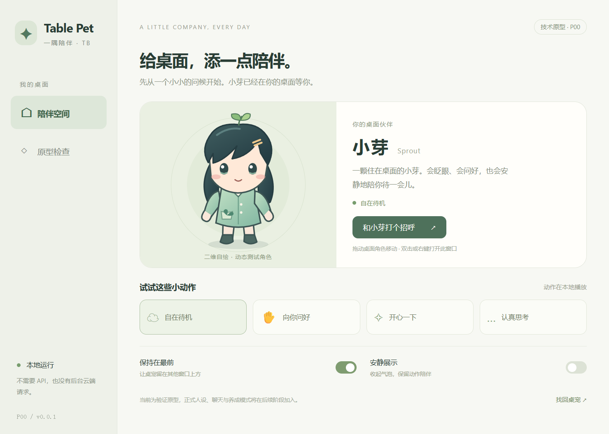

# Table Pet TB · 智能桌宠

以动态角色和日常陪伴为核心，逐步加入提醒、便签、桌面操作与 AI 工作能力的桌宠项目。

**当前阶段：P00 Windows 技术原型（0.0.1）。** 已有应用源代码和可运行的离线桌宠：动态角色、点击与拖动、透明区穿透、独立控制台、托盘和设置恢复。尚无安装包；AI 对话、三种互动模式与工作功能按后续阶段实施。



## 运行原型

Windows x64 + Node.js 24.x，在仓库根目录执行：

```powershell
npm ci
npm run setup:runtime
npm run build
npm start
```

首次下载依赖需要网络，之后运行无需 API、账号或本地模型。Electron 官方下载较慢时可用 `npm run setup:runtime -- -Source mirror`，仍核对官方 SHA-256。开发热更新使用 `npm run dev`。

单击角色问候，拖动移动，双击／右键打开控制台；关闭控制台仍在托盘运行，从托盘退出。详细环境、测试命令与数据位置见[开发说明](docs/development.md)，已测范围和性能见[P00 验收记录](docs/verification/P00.md)。

## 项目方向

- **陪伴优先**：动态立绘、点击与拖动反馈、表情动作和日常互动。
- **API 可选**：基础桌宠可以在不配置 API、不安装模型的情况下使用。
- **人设可编辑**：启用 AI 后，按用户设定的人物性格、背景和说话方式聊天。
- **工作能力逐步加入**：先完成陪伴体验，再加入本地工具、截图理解与复杂任务。

已确认先做 **Windows 个人自用版**，角色采用二维二次元／卡通方向。P00 使用自绘 SVG 动态测试角色“小芽”，正式角色与 Live2D 模型仍未确定。语音与本地 AI 留待后续更新，云端 AI 暂不设置预算，测试时再确认。

## 功能路线（包含尚未实现的目标）

| 能力 | 计划体验 | 阶段 |
|---|---|---|
| 动态立绘与本地互动 | 待机、眨眼、点击拖动、预设台词、免打扰 | P00—P01 |
| 可选互动模式 | 安静陪伴、偶尔问候、丰富养成，可调整主动程度 | P01，复杂养成后续扩展 |
| 可选 AI 对话 | 主动配置 API，流式聊天，可随时关闭 | P02 |
| 自定义角色 | 编辑名称、称呼、性格、背景、关系与对话风格 | P01 保存，P02 用于 AI 对话 |
| Agent 动作调用 | 在已有动作中选择挥手、思考、开心等表现 | P02 |
| 提醒与便签 | 定时提醒、便签关联提醒、重启恢复与稍后通知 | P03 |
| 打开应用 | 通过按钮或对话启动配置的软件、浏览器或 B 站网页 | P03 |
| API 与模型选择 | 多配置、手动选择、按能力自动选择；预算限制可选 | P03 |
| 屏幕理解 | 可开关的整屏、窗口或区域截图，按需调用视觉模型 | P04 |
| 快捷工作 | 全局快捷键截图、快速提示词、独立专业会话与结果保存 | P04 |
| 高级工作扩展 | 可替换 Agent 引擎、限定目标与时长的持续查看 | P05，可选 |

## 使用方式规划

| 方式 | 需要什么 | 能力边界 |
|---|---|---|
| 基础桌宠 | 无需 API Key、账号或本地模型 | 动画和预设互动，以及对应阶段已交付的本地工具 |
| 云端 AI | 用户主动配置可用的 API 与模型 | 智能对话、工具调用；图片理解取决于模型能力 |
| 本地 AI | 后续更新再加入兼容的本地模型 | 不纳入当前首版，能力与性能取决于模型和硬件 |

未使用模型时，预设台词不具备开放式理解与推理能力。角色档案独立保存，关闭 AI 或切换供应商不应丢失设定；不同模型的角色表现仍需实际验证。

## 开发路线

| 阶段 | 目标 | 状态 |
|---|---|---|
| [P00 项目启动与技术验证](docs/plans/P00-项目启动与技术验证.md) | 验证窗口、渲染、素材、开发环境与性能基线 | 已交付，限定范围 G00 通过 |
| [P01 无 API 桌宠基础版](docs/plans/P01-无API桌宠基础版.md) | 交付离线基础互动与角色设置 | 尚未开始 |
| [P02 可选 API 与角色对话](docs/plans/P02-可选API与角色对话.md) | 交付角色聊天和受控动作调用 | 尚未开始 |
| [P03 本地工具与模型选择](docs/plans/P03-本地工具与模型选择.md) | 提醒、便签、打开软件与多模型路由 | 尚未开始 |
| [P04 屏幕理解与快捷工作](docs/plans/P04-屏幕理解与快捷工作.md) | 单次截图、专业模式和快捷输入 | 尚未开始 |
| [P05 Agent 扩展与持续查看](docs/plans/P05-Agent扩展与持续查看.md) | 按需验证工作引擎与持续查看 | 尚未开始，可选 |
| [P06 稳定性与打包验收](docs/plans/P06-稳定性与打包验收.md) | 数据恢复、长期运行和本地安装包 | 尚未开始 |

P04 计划覆盖已确认需求的基础实现；P05 不阻塞基础桌宠和单次截图工作。阶段计划共拆分为 51 项任务、48 个验收场景，编号与完成条件见[计划总览](docs/plans/README.md)。这些数量表示规划范围，不表示已实现或已通过验收。

## 文档导航

建议依次阅读：

1. [产品构思](docs/项目构思-v0.1.md)：产品定位、功能可行性与架构建议。
2. [开发计划总览](docs/plans/README.md)：执行顺序、里程碑和阶段入口。
3. [需求基线与验收映射](docs/plans/00-需求基线与验收映射.md)：十项需求与验收场景的对应关系。
4. [决策、依赖与风险](docs/plans/01-决策依赖与风险.md)：已确认要求与待验证选择。
5. [可选增强路线](docs/plans/02-可选增强路线.md)：本地模型、语音、多角色、知识库等后续方向。
6. [产品选择与互动模式](docs/plans/03-产品选择与互动模式.md)：已确认的首版范围、素材准备与三种陪伴模式。
7. [P00 阶段复盘](docs/retrospectives/P00-阶段复盘.md)：已有证据、产品体验缺口、数据与性能改进，以及 P01 实施顺序。
8. [Gemini 角色绘图提示词](docs/art/Gemini-雪乃桌宠提示词-v0.1.md)：暂定雪乃角色的首批 12 张素材、可选扩展和统一导出要求。

## 当前技术

原型采用 Electron、TypeScript、React 和 SVG／CSS 动画，设置保存为带版本的本地 JSON。进程边界和后续演进见[技术决策](docs/architecture/P00-decisions.md)。Live2D、SQLite 和 DeepSeek Harness 保留为相关阶段候选，目前均不是必装依赖。

当前“安静展示”仅控制气泡可见性，不能代表三种互动模式已完成。多屏硬件、实际中文输入法候选框、Live2D 与长期运行仍需进一步验证。

## 获取文档与参与

可以直接在 GitHub 阅读，也可以克隆仓库：

```bash
git clone https://github.com/BBBOYRE/Table_Pet_TB.git
cd Table_Pet_TB
```

欢迎围绕阶段计划提出问题和建议。提交方式见[贡献说明](CONTRIBUTING.md)，文档变更见[变更记录](CHANGELOG.md)。

## 许可证与素材

项目许可证尚未确定，目前未附开源许可证。当前测试美术和后续素材路线见[素材清单](docs/assets.md)。后续角色、动作、字体、SDK 和其他第三方资源需要分别记录来源及许可，不能视为随仓库自动授权。
