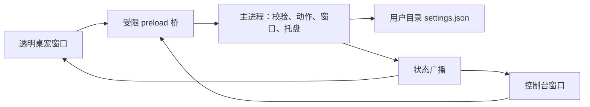

# P00 技术决策

日期：2026-10-20。对应 P00-T02—T07；测量和支持范围见[验收记录](../verification/P00.md)。

## 框架与渲染

采用 Electron + TypeScript + React 实现 Windows 原型。Electron 提供透明窗口、托盘与显示器坐标 API；界面与未来聊天复用 Web 组件。现阶段不用 SQLite：只有少量设置，使用带版本的 JSON 和临时文件替换，后续提醒、档案和会话增长时再决定迁移方式。

精确版本由 `package-lock.json` 锁定：Electron 44.9.1、React 19.3.1、TypeScript 7.0.2、electron-vite 6.0.0、Vite 8.3.4、Playwright 1.64.1。Node.js 基线为 24.x；版本更新需重跑窗口与鼠标验证，不能只确认编译通过。

当前角色使用本仓库编写的 SVG 和 CSS 动画，实际支持呼吸、眨眼、问候挥手、开心跳跃、思考姿态。它是可运行的二维动态替代方案，不是静态占位截图；也不是 Live2D 模型或正式角色定稿。用户尚无模型，先用此方案解除窗口与基础互动的素材依赖。

Live2D 仍是候选，未下载 SDK、未导入真实模型、未完成专项验证，因此不宣称不兼容或已被淘汰。是否引入取决于正式形象的表现需求、可授权素材与额外运行成本。当前清单只接受 `svg-prototype`；未来新增渲染器需要代码适配，不是替换一个模型文件就能使用。

## 进程与输入

桌宠窗口不取得键盘焦点，控制台独立负责文本输入。主进程协调窗口和动作；界面只通过类型化桥提交命令，不能执行任意系统命令。所有窗口启用隔离与沙箱，关闭 Node 集成，阻止新窗口和导航。P00 拦截外部 HTTP(S)／WebSocket 请求；开发态仅允许自身 Vite 地址。

命中判断使用 SVG 实际绘制图形和显式交互按钮。Windows 在重建透明窗口后曾出现鼠标移动转发缺失，故增加每 50ms 的窗口内坐标探测：仅光标进入本窗口范围才向界面请求命中判断，窗外直接保持穿透；不读取桌面像素，不记录输入历史。拖动期间固定命中并每 16ms 更新位置，松开后夹回显示器工作区并保存，15 秒超时兜底。

关闭控制台不会退出；托盘提供找回位置、恢复角色和退出入口。角色数据异常显示可恢复占位；渲染进程崩溃时释放拖动、开启穿透并打开控制台，可重新加载角色。位置恢复支持负坐标和缺失显示器的计算路径，真实多屏兼容性仍需设备验证。

## 动作边界

`idle`、`greet`、`happy`、`thinking` 是语义动作。主进程检查动作是否在角色清单内，约束切换频率，主动动作结束后回待机。P02 的模型只能请求已有动作，不把供应商输出直接当作脚本执行。本阶段尚无 Agent 或 AI 请求。

## 下一阶段

P01 继续保留窗口和动作服务，新增本地事件策略、三种主动互动模式、免打扰与角色档案。人物背景、称呼和说话方式与互动频率分开保存。P02 再添加可取消的供应商适配器，默认关闭，网络请求不得阻塞角色动画。语音、本地 AI 继续留在后续路线。
