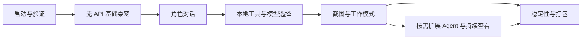

# 智能桌宠开发计划总览

更新日期：2026-10-20。计划版本：1.2。当前状态：P00 原型已交付，G00 在已测范围内通过；P01—P06 尚未开始。

本计划将[产品构思](../项目构思-v0.1.md)细化为可以逐项实施和验收的工作。以已确认要求为基线：Windows 个人自用、二维二次元／卡通角色、API 可选、自定义人物性格与背景，以及可选择的主动互动模式。P00 已有 SVG 动态测试角色，正式素材与 Live2D 专项待定；语音和本地 AI 后续更新，云端预算测试时再确认。框架现状见[技术决策](../architecture/P00-decisions.md)。

## 1. 执行顺序与交付

| 阶段 | 目标 | 主要交付 | 进入条件 | 当前状态 |
|---|---|---|---|---|
| [P00 项目启动与技术验证](P00-项目启动与技术验证.md) | 验证框架、素材和桌面交互 | 可运行验证样例、技术决策、性能基线 | 当前需求文档 | 已交付，限定范围 G00 通过，见[验收记录](../verification/P00.md) |
| [P01 无 API 桌宠基础版](P01-无API桌宠基础版.md) | 不配置模型也能持续使用 | 立绘互动、三种互动模式、设置、角色档案 | G00 通过 | 尚未开始 |
| [P02 可选 API 与角色对话](P02-可选API与角色对话.md) | 开启 AI 后有稳定角色表现 | 可选接入、流式聊天、自定义性格背景、动作调用 | G01 通过 | 尚未开始 |
| [P03 本地工具与模型选择](P03-本地工具与模型选择.md) | 成为日常可用的桌面助手 | 提醒、便签、打开软件、多模型手动与自动选择 | G02 通过；本地工具可在 G01 后先实施 | 尚未开始 |
| [P04 屏幕理解与快捷工作](P04-屏幕理解与快捷工作.md) | 用户主动截图后快速工作 | 目标选择、截图开关、专业模式、快捷输入 | G03 通过 | 尚未开始 |
| [P05 Agent 扩展与持续查看](P05-Agent扩展与持续查看.md) | 按需增加复杂任务能力 | 工作引擎适配、任务取消、限定目标的持续查看 | G04 通过；按实际需要启用 | 尚未开始 |
| [P06 稳定性与打包验收](P06-稳定性与打包验收.md) | 将已完成能力做成可安装版本 | 本地安装包、迁移与恢复、运行检查、使用说明 | G04 通过；纳入 P05 能力时要求 G05 通过 | 尚未开始 |

`Gxx` 是阶段完成条件，具体条目见对应阶段文档。验收证据不存在时，不将阶段标记为完成。

P05 的 Harness 集成和持续查看是增强阶段，不是基础桌宠启动或 P04 单次截图工作的前置条件。P03 的工具可先从本地入口实施，模型调用工具的整合在 P02 后完成。这是实现顺序安排，不要求并行开发或多 Agent。

## 2. 可以逐步使用的里程碑

- **M1 基础桌宠**：P01 完成；不需要账号、API Key 或本地模型，具备角色动画和可选择的安静、问候、轻量养成互动。
- **M2 AI 陪伴**：P02 完成；API 仍可关闭，启用时支持自定义人物性格与背景。
- **M3 日常助手**：P03 完成；提醒、便签与打开软件在无 AI 时也可使用。
- **M4 快捷工作**：P04 完成；覆盖首轮已确认需求的基础实现，包括截图理解与专业模式。
- **M5 可安装版本**：P06 完成；对纳入版本的功能完成打包、稳定性和数据恢复验收。

每个里程碑均可独立试用。提醒与便签从 M3 开始提供，不能将它们误标为 M1 已交付功能。

## 3. 计划文档导航

- [需求基线与验收映射](00-需求基线与验收映射.md)：核对每个已确认需求在哪个阶段落实。
- [决策、依赖与风险](01-决策依赖与风险.md)：区分已确认要求、工作假设和待验证事项。
- [可选增强路线](02-可选增强路线.md)：本地模型、语音、皮肤和其他后续建议。
- [产品选择与互动模式](03-产品选择与互动模式.md)：已确认的五项选择、素材准备、模式行为与预算未设置状态。
- P00—P06：每阶段包含进入条件、范围、任务、交付物、验收和失败处理。

## 4. 通用执行规则

1. 实施时按阶段任务编号推进，例如 `P02-T03`；完成一项后记录实际变更和验证结果。
2. 先让核心路径可运行，再做扩展。基础桌宠不得依赖 AI 服务就绪、工作引擎启动或额外模型下载。
3. 验收记录建议保存为 `docs/verification/Pxx.md`，包含构建版本、环境、步骤、预期、实际结果和未解决问题。该目录及记录在实际验证时创建。
4. 图形表现用截图或短录屏辅助检查；持久化、提醒去重、请求取消等关键行为用针对性自动化检查。避免为纯文案或低影响样式堆叠测试。
5. 功能失败必须有可理解的反馈。不能以模型的一句“已完成”代替本地工具的实际执行结果。
6. 技术选型和软件依赖在首次实施时记录准确版本；不把当前文档的候选框架当作已经验证的结论。
7. 每阶段结束同步状态、已知限制和下一阶段前置条件。修改范围时更新需求映射，避免新增功能无验收、已有要求被遗忘。

## 5. 时间与资源安排

目前没有确认开发投入、截止日期、最终角色素材和目标电脑性能，因此不编造日历工期。P00 完成后，依据实际技术难点、素材准备和投入时间估算 P01—P03；P03 完成后再估算视觉与 Agent 阶段。

原创 Live2D 制作属于独立素材工作，应单独估算。测试模型可以用于验证流程，但不能自动视为最终可分发素材。

P00 已建立开发入口和可运行原型；实际覆盖及待补设备检查见验收记录。下一阶段为 **P01 无 API 桌宠基础版**，从三种本地互动策略与角色档案开始，尚未实施。
