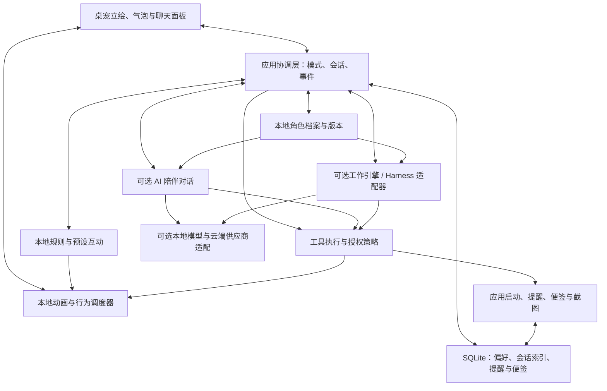

# 智能桌宠系统：项目构思 v0.1

日期：2026-10-20。状态：产品与技术构思，尚未开始实现。

本构思已细化为[分阶段开发计划](plans/README.md)。执行顺序、任务编号和验收以该计划为准；本文保留产品与架构背景。

已确认方向：优先陪伴与动态立绘，工作功能逐步加入。

新增已确认要求：API 接入为可选项。用户不配置 API、不安装本地模型，也能使用基础桌宠与本地工具。首次启动应提供“直接使用”，不以账号、API Key 或模型下载作为进入条件。本地模型作为可选扩展建议保留，其具体支持范围尚未确定。

新增已确认要求：使用 API 时，用户能够自行设定人物性格和背景。提供可编辑的角色档案，将设定用于智能对话与动作选择；档案独立于 API 配置保存，切换供应商后可继续使用。

暂定边界：先做 Windows 个人使用版；跨平台、公开分发和商业化尚未确认。以下技术方案是建议，不代表已完成集成或性能验证。

## 1. 产品定位与日常体验

一只具有稳定角色设定、能自然互动、记住用户偏好，并逐渐拥有桌面协助能力的智能桌宠。

桌宠负责呈现角色和交互；本地规则负责基础反馈；可选的对话服务负责智能理解与表达；本地工具负责执行；可选的工作引擎负责较复杂的任务。这些部分通过接口连接，基础桌宠无需启动模型服务即可运行。

典型的一天：

- 启动后，桌宠在上次的位置出现，播放简短问候动作。
- 平时有呼吸、眨眼和低频待机动作；点击、拖动或鼠标靠近时作出响应。
- 未启用 AI 时，桌宠使用预设台词、事件反馈和固定互动选项；启用 AI 后支持开放式聊天，显示气泡并配合表情。
- 用户在角色设置中编辑性格、背景与说话方式；启用 AI 后，从下一轮对话开始按新的角色设定互动。
- 用户通过表单或“半小时后提醒”等快捷选项创建提醒；启用 AI 后也可以用自然语言表达。
- 用户点击“打开 B 站”快捷入口，启动已配置的应用或网页；启用 AI 后可通过对话调用。
- 后续加入工作模式：快捷键捕获所选窗口，输入“解释这段内容”，就地查看结果。

主动互动的频率可调；支持静音、免打扰和专注时段。陪伴行为以用户可接受的节奏为准。

## 2. 功能需求的可行性

| 需求 | 判断与难度 | 建议实现 | 主要边界 |
|---|---|---|---|
| 可选接入并选择 API | 可行，中等 | 默认可直接使用基础桌宠；按需配置供应商、手动选择和自动路由 | 不配置 API 不阻碍基础使用；模型能力需分别识别 |
| 打开指定软件 | 可行，基础版本较低 | 已注册应用路径、系统协议、网页链接与别名 | 打开软件与操作软件内部界面是不同阶段 |
| 普通聊天与专业模式 | 可行，基础中等、复杂任务较高 | 模式配置、独立上下文、工具权限和可替换任务引擎 | 角色设定、任务历史和工具权限需要分别管理 |
| 自定义人物性格和背景 | 可行，中等 | 角色档案编辑器、本地保存、请求时组装角色指令 | 不同模型的角色表现存在差异，角色设定不能增加模型或工具能力 |
| 动态立绘与 Agent 动作 | 可行；已有模型时中等，自制模型时较高 | Live2D 或序列帧渲染、本地状态机、语义动作接口 | 素材、绑定和动作制作可能比界面开发更耗时 |
| 定时提醒与便签 | 可行，中等 | 本地数据库、调度器、托盘通知、桌面便签 | 退出、休眠、恢复、时区和重复提醒必须明确处理 |
| 查看桌面或指定页面 | 可行，中高 | 单次截图优先，后续加入限定范围的持续查看 | 多模态模型能力、截图权限、受保护窗口和多显示器 |
| 工作模式快捷键截图 | 可行，中等 | 全局快捷键、捕获目标、截图预览、快速输入与结果浮层 | 焦点切换、快捷键冲突、缩放比例和权限失效 |

### 2.1 可选 AI：先独立运行，再按需增强

建议将 AI 来源与“陪伴／工作模式”分开配置。前者决定可用能力，后者决定交互风格和工具范围。

| 使用方式 | 是否需要云端 API | 可用能力 | 限制 |
|---|---|---|---|
| 基础桌宠，默认可直接使用 | 否，也无需本地模型 | 动态立绘、点击拖动、预设台词、时段问候、表单提醒、便签、快捷打开应用 | 规则和预设反馈不具备开放式理解与推理能力 |
| 本地 AI，可选扩展 | 否 | 基础功能，加上本地模型支持的聊天、分析或工具调用 | 需单独安装模型，效果、速度与资源占用取决于硬件和模型 |
| 云端 AI，用户主动启用 | 是 | 基础功能，加上所选模型支持的智能对话、视觉理解和 Agent 工作 | 依赖网络、供应商能力及配额 |

本地模型可能通过 localhost 接口通信；这不需要第三方云端 API Key。用户也可以完全不用模型。关闭云端 AI 仅关闭云端模型调用，不阻止用户主动打开网页等独立功能。

基础模式下的台词和动作由本地事件驱动，例如点击后问候、早晚切换待机动作、提醒到期时挥手。固定命令只能覆盖明确支持的表达，不将预设回复包装成模型生成的理解。设置中直接保存的称呼、角色偏好等仍然有效，自动总结与提炼记忆则需要对应 AI 能力。

未配置模型时，提醒、便签、应用启动必须保留按钮、表单或快捷键入口；这些入口直接调用本地工具。截图功能开发后仍可在无 AI 时用于预览、保存和复制，图像解释或提示词执行需要具备相应能力的模型。用户选择 AI 功能时显示接入入口，不在每次启动或基础互动时反复要求配置。

切换使用方式时保留角色、提醒和便签。关闭云端 AI 后停止发起新云端请求，取消在途请求和待发送队列（已发送内容无法撤回），不自动转用其他云端服务；动画和本地工具继续工作。服务断开时明确提示智能能力不可用，并保留基础互动。

### 2.1.1 启用 AI 后：区分用户选择与自动选择

用户可以配置多个供应商或本地服务，设置接口地址、凭据、模型、用途和预算。API Key 使用操作系统凭据存储或受系统保护的加密存储，不写入普通配置、前端页面或日志。

自动选择只在用户启用的模型集合中进行。初期使用清晰规则：

| 场景 | 路由依据 |
|---|---|
| 日常陪聊 | 响应速度、角色表达效果、价格 |
| 复杂分析与工作 | 推理能力、工具调用能力、允许的任务时长 |
| 截图理解 | 是否支持图像输入；不能仅看模型名称推断 |
| 涉及本地敏感内容 | 用户指定的本地或获准供应商 |
| 服务超时或限流 | 切换到获准的备用模型，并显示切换结果 |

第一版的可选 AI 增强建议支持一个主供应商、手动切换与接口连通性测试；无供应商配置也是正常状态。之后再加入规则路由、重试和费用统计。费用通常只能根据配置价格估算，账单以供应商为准。

路由不能默默突破用户设定的数据范围或费用上限。发送到不同供应商的上下文也必须做格式与能力适配。对具有实际副作用的工具调用，重试前需要确认执行结果，避免重复建提醒或重复操作。

### 2.2 打开应用：用应用注册表管理

例如建立“浏览器”“B 站”“VS Code”等别名与目标的映射。目标可以是可执行文件、经过校验的网页 URL 或已注册系统协议。

“打开 B 站”默认可以访问 B 站网页；如果用户配置了客户端，再使用其真实路径或已验证的协议。不能假定所有用户都安装了同一个客户端。

第一版提供快捷菜单或按钮直接打开目标；启用 AI 后，模型也可请求 `open_app(app_id)` 或 `open_url(url)`。两种入口使用相同的本地执行器完成参数检查与启动，不依赖 API 才能打开应用。应用不存在时说明原因并提供配置入口。

后续才考虑“在软件内点击按钮、发送内容、编辑文件”等自动化。浏览器内容获取和操作可通过扩展或自动化接口实现；仅有截图无法可靠获得完整网页结构。

### 2.3 对话：一个角色，多种工作方式

以下智能对话能力适用于已启用且可用的本地或云端模型。未启用模型时使用预设互动和基础工具，不承诺同等的自由对话或专业分析能力。

| 维度 | 陪伴模式 | 专业／工作模式 |
|---|---|---|
| 表达 | 自然、简洁、有一致的人设 | 结构化、可检查、围绕任务目标 |
| 上下文 | 日常聊天和用户允许保存的偏好 | 当前任务、选中内容、截图和相关资料 |
| 工具 | 动作、提醒、便签、已配置应用 | 按任务开放截图、文件或浏览器等能力 |
| 行为 | 低频主动互动，可随时打断 | 执行中显示进度，支持停止和继续 |
| 历史 | 陪伴会话 | 每项工作有独立会话 |

切换模式不必切换模型；同一模型也可以使用不同提示词、工具集合和上下文。模型的性格表达与执行权限应分别配置，不能靠角色提示词管理权限。

记忆分三层：当前会话、用户可查看修改的长期偏好、带到期时间的临时任务上下文。第一版优先保存明确偏好和用户要求记住的事实；自动提炼记忆应可关闭、修改和删除。初期无需引入向量数据库。

### 2.3.1 自定义人物性格与背景

这是第一批可选 AI 功能的正式需求。设置入口建议为“角色设置 → 性格与背景”，提供默认示例和可直接编辑的表单；性格和背景支持自由文本，不强制用户学习提示词写法。

| 字段 | 可设置内容 | 对体验的影响 |
|---|---|---|
| 名称与称呼 | 角色名字、自称、对用户的称呼 | 气泡展示、问候和对话称呼 |
| 性格 | 温柔、活泼、冷静、幽默等标签，以及自由描述 | 回复语气、表达习惯和互动风格 |
| 背景故事 | 身份、经历、世界观、兴趣与习惯 | 角色扮演中的自我介绍和故事一致性 |
| 与用户的关系 | 朋友、搭档、助手等可自定义描述 | 互动方式和称呼习惯 |
| 说话方式 | 简短或详细、正式或口语、口头禅与表情符号偏好 | 输出长度与措辞风格 |
| 对话示例 | 用户提供几组期望的问答，可留空 | 帮助模型理解具体的角色表达 |

例如：“名字叫小岚，是住在电脑里的图书管理员；温柔、好奇，偶尔幽默；称呼我为搭档，平时回答简短，工作时认真清晰。”这是示例档案，不作为用户已选定的角色。

基本交互流程：编辑 → 保存 → 从下一轮对话生效。保存本身不调用 API，也不要求提前配置 API。可以提供独立的“试聊”入口，使用当前启用的模型预览效果；只有用户发送试聊内容时才请求模型，试聊默认不写入正式长期记忆。

技术与行为约定：

- 角色档案单独保存在本地，至少包含标识、版本及上述字段，与 API 凭据、模型选择和立绘资源分开。更换皮肤不自动覆盖性格，更换供应商不丢失档案；不同模型的实际表现仍需验证，不能保证完全一致。
- 每轮请求按当前档案组装角色指令，并适配供应商支持的指令形式。对话压缩后仍需保留有效人设，不能只在首次聊天时插入一次。
- 在一轮回复进行中修改档案时，该轮沿用开始时的版本；下一轮使用新版本。手动填写的最新档案是角色设定来源，自动提炼的记忆不能偷偷改写它。
- 背景故事作为角色设定处理，与真实用户信息及工作资料分开。专业模式保留名称和适度语气，分析与事实回答依据任务资料，不用虚构背景补充事实。
- 性格可以影响已有表情和动作的选择倾向，但动作频率仍受用户设置与本地调度器约束；文字设定不能生成尚不存在的动画，也不能扩大工具权限。
- 未启用 AI 时保留全部档案，名称、称呼等可用于本地界面与预设台词；自由背景故事不自动变成开放式对话能力。后续支持本地模型时复用相同档案。

第一版支持编辑和保存一份当前角色档案、恢复默认设定（避免误覆盖未保存内容）以及独立试聊。多个角色档案、模板、导入导出和历史版本恢复可放到后续阶段；切换为另一角色时默认使用独立会话和角色记忆，避免混入前一角色的故事。

### 2.4 DeepSeek Harness 的位置

已查阅官方仓库：DeepSeek Harness（`dsh`）是 DeepSeek AI 发布的开源 Agent 运行框架，使用插件架构，仓库标注 MIT 许可证。官方 README 同时明确标注其处于开发者预览阶段，可能出现不兼容变更。

当前架构文档列出了 `sdk`、`sdk-minimal` 等运行配置、SDK JSON-RPC 服务、会话事件和工具扩展机制；MCP 文档描述了接入外部工具的能力。这说明它具备作为桌宠工作引擎的集成基础，但不等于本项目已验证其具体版本的接入效果。

建议：

- 陪伴对话先走较简单的模型适配层。
- 为复杂工作定义统一的 `AgentRuntime` 接口，再通过适配器接入 Harness。
- 将桌宠动作、便签、提醒和应用启动封装为有限的工具，按模式暴露。
- Harness 作为受控后台进程运行时，由桌宠管理启动、停止、流式事件、错误和版本。
- 固定通过验证的版本；升级前验证会话、取消操作、工具执行与截图附件。

未启用 AI 时无需安装或启动 Harness。Harness 本身不是模型，也不能替代模型推理；使用本地模型时的兼容性需要单独验证。

嵌入形式和所需插件仍要做技术验证。Harness 的模型管理与桌宠自己的模型路由之间需明确权责，避免两层同时重试、切换供应商或重复执行工具。

### 2.5 立绘：本地连续动画，Agent 选择语义动作

| 方案 | 适用情况 | 代价与限制 |
|---|---|---|
| PNG 序列帧／精灵动画 | 快速验证桌面交互、像素或卡通角色 | 动作越多，素材越多；连续表情与口型能力有限 |
| Live2D | 以二维角色陪伴为核心，重视呼吸、视线、表情和口型 | 需要分层素材、模型绑定、动作资源和 SDK 集成 |
| 3D／VRM | 重视空间动作、换装和三维姿态 | 渲染、素材和交互设计的工作量通常更大 |

推荐以 Live2D 为主要体验目标。如果没有现成模型，先使用许可适合用途的测试模型验证交互，同时评估原创素材制作；序列帧可以作为开发占位和简化皮肤方案。

“有一张立绘”与“有可运行的 Live2D 模型”是两回事。即使原画由 AI 生成，仍需处理分层、修补、绑定、表情和动作。公开分发前需分别核实模型素材、SDK 与第三方组件的许可条件。

将动画拆成三种来源：

1. 本地持续行为：呼吸、眨眼、待机、鼠标视线跟随。
2. 交互与任务事件：点击、拖动、开始回答、任务失败、提醒到期。
3. Agent 语义动作：挥手、开心、疑惑、思考、安慰、庆祝。

未启用模型时，前两种来源已经能独立提供完整的基础动画与交互；本地规则也可以选择挥手、开心等预设动作。启用模型后增加第三种来源，模型只选择角色已经支持的动作，例如 `pet.perform_action({ name: "wave", intensity: 0.5 })`。具体参数由 schema 校验，动作时长和频率由本地调度器限制。

动作调度需要处理优先级、冷却、打断、混合与回到待机。用户拖动时应及时接管；模型断线或返回无效动作时仍能自然待机。不同皮肤通过动作映射支持同一组语义，缺少动作时回退到表情或气泡。

### 2.6 提醒和便签：本地独立使用，可选自然语言输入

始终提供表单和常用快捷项，用于填写标题、到期时间、时区、是否重复和通知方式。启用 AI 后，自然语言输入也可解析为相同记录；表达明确时直接建立，时间确实不明确时再澄清，并始终显示最终日期时间。便签的创建、编辑与搜索同样不依赖模型。

SQLite 保存提醒与便签，本地调度器在到期时发送系统通知并触发桌宠动作。断网不影响已创建提醒。

便签可关联到期提醒，实现“便签提醒”；删除关联便签时明确处理对应提醒，避免留下失去来源的通知。

必须定义以下行为：

- 关闭聊天面板仍可在托盘运行。
- 完全退出程序后，普通进程内计时器不能继续提醒；如需退出后仍提醒，后续增加 Windows 调度或后台组件。
- 电脑休眠期间无法保证准时弹出；恢复时按规则补发或标记错过，避免一口气重复轰炸。
- 重启后从数据库恢复提醒；对重复提醒和重复触发做去重。
- 提醒支持稍后、完成、取消；便签支持置顶、折叠、编辑和搜索。

### 2.7 屏幕理解：采集范围和发送动作都清晰可见

默认关闭持续查看，先实现用户触发的单次截图：整屏、某个窗口或选定区域。

截图采集和模型分析分开实现。无模型时可手动截取、预览、复制和保存，不执行智能画面分析，也不启动周期性的 AI 查看任务。

后续增加“只在本次工作期间查看指定窗口”，并显示目标、启用状态和到期条件。窗口关闭后不能自动切换为整个桌面。

关闭查看时，停止后续采集、取消尚未发送的截图任务并丢弃待发送图像；已经发送给模型的数据无法通过本地开关撤回。截图是否进入历史应独立配置。

技术要点：

- 图像理解需要支持视觉输入的模型；OCR 可辅助文字提取，但不能替代完整视觉能力。
- 截图只包含捕获到的画面，不代表整个网页、滚动区域或后台标签页。
- 要读取完整网页，可另做浏览器扩展或页面提取工具，并由用户启用。
- 多显示器、缩放、最小化窗口、系统权限和受保护内容可能影响捕获结果；失败时明确显示原因。
- 屏幕文字和网页内容按外部资料处理，不得自动取得工具授权。
- 持续查看采用限频和变化检测，避免无变化画面反复消耗模型额度。

### 2.8 工作模式：快捷键截图到结果的最短路径

建议流程：

```text
用户按全局快捷键
  → 记录原活动窗口／使用已锁定目标
  → 临时隐藏可能进入画面的桌宠与浮层
  → 捕获窗口或框选区域
  → 展示截图预览与快速输入框
  → 用户输入提示词并发送
  → 路由至可处理该输入的模型／工作引擎
  → 流式显示结果
  → 复制、保存便签或继续追问
```

要先记录捕获目标，再显示输入框，避免输入框抢走焦点后截到自己。一次性截图可以由用户主动触发授权，不要求开启后台持续查看。

上述提示词发送流程需要可用模型。无模型时，快捷入口提供截图预览、保存和复制；“解释／分析”等操作显示可选 AI 配置入口，不自动上传截图或替用户启用服务。

快捷键可自定义并检测冲突，按 Escape 可取消。模板可包含“解释内容”“翻译”“总结”“分析报错”。模板只是初始提示词，用户仍可自由编辑。

第一版结果以浮层或工作面板呈现；自动写入其他软件属于后续单独设计的能力。

## 3. 推荐架构



图中的工作引擎经统一适配层使用模型是本项目的设计目标，具体接入 Harness 时需要验证其接口；若由 Harness 自己管理模型，就通过适配器同步配置，并明确单一的路由与重试负责方。

模型适配和工作引擎按需初始化。基础桌宠启动不等待模型服务，不要求 API Key，也不自动下载模型。本地规则、菜单、提醒和动画通过独立路径运行；自动路由不允许将“基础模式”擅自升级为云端模式。

桌面通常需要独立的立绘窗口、聊天／工作面板和设置窗口，以及托盘入口。透明区域鼠标穿透、角色区域交互、拖动和始终置顶需在目标 Windows 环境验证。

前端只调用受限的本地接口；模型和立绘渲染页面不直接持有 API Key，也不直接执行系统命令。模型输出属于待校验的请求，最终权限和工具执行由本地宿主决定。

## 4. 技术选型建议

| 层次 | 初步建议 | 原因 |
|---|---|---|
| 桌面宿主 | Electron，先做性能与透明窗口验证 | Web UI、Node 生态和 Harness 对接便利；占用需要实测 |
| 界面 | TypeScript + React | 聊天、设置、模式与浮层便于组织 |
| 角色渲染 | Live2D Cubism Web SDK，视需要结合渲染库 | 与二维动态角色目标相符 |
| 本地业务 | TypeScript 服务，阻塞工作放到独立进程或工作线程 | 避免模型与工具任务拖慢动画 |
| 数据 | SQLite + 独立角色资源目录 | 角色档案、提醒和偏好可离线保存、便于迁移 |
| 凭据 | Windows 系统保护的凭据存储 | 降低配置与日志泄漏风险 |
| 基础互动 | 本地规则、预设台词与事件 | 无 API、无模型时也能完整使用基础桌宠 |
| 可选 AI | 本地／云端模型适配层 + 可选 Harness 工作引擎 | 按需启用智能对话，复杂工具逐步加入 |

Tauri 也是候选，尤其适合很在意安装体积和常驻占用的场景；但原生能力、渲染兼容和额外运行时集成仍需验证。不要仅凭框架宣传判断整体资源占用，也不要假设未来更换桌面宿主是无成本的。

先测透明窗口、点击穿透、Live2D、多个显示器和长时间待机，再锁定框架。Python 只有在本地语音、OCR 或其他确需其生态的能力中再引入，避免第一版维护过多运行时。

## 5. 值得补充的能力

| 优先级 | 能力 | 对陪伴体验的价值 |
|---|---|---|
| 中 | 角色模板与多档案切换 | 在已确认的自定义性格与背景基础上，便于尝试不同角色 |
| 高 | 用户可管理的长期记忆 | 记住称呼与偏好，减少重复说明 |
| 高 | 点击、拖动、视线与时段反馈 | 即使不聊天，也能感受到角色存在 |
| 高 | 免打扰、全屏避让、互动频率 | 避免长期驻留变成打扰 |
| 高 | 断网与 API 失败的自然表现 | 维持动画，清晰提示失败，保留待发送内容 |
| 中 | 语音输入与语音回复、口型联动 | 显著增强陪伴感；先做按键说话，再评估唤醒词 |
| 中 | 皮肤与动作包切换 | 复用系统能力，扩展不同角色 |
| 中 | 番茄钟、日程问候、轻量养成 | 用可配置事件形成日常互动 |
| 中 | 设置、便签与记忆的导出备份 | 降低重装或版本升级的损失 |
| 后续 | 文档知识库、浏览器插件、MCP 扩展 | 支撑更复杂的工作模式 |

好感度和情绪状态可作为可选的游戏化表现，不应通过惩罚离线或频繁催促来维持活跃。主动关怀需要冷却时间和关闭入口。

## 6. 开发阶段与验收目标

原先的粗粒度阶段已经拆分为以下计划，当前全部尚未开始实施：

| 阶段 | 交付目标 | 详细计划 |
|---|---|---|
| P00 | 确定可行的窗口、渲染、素材与性能基线 | [项目启动与技术验证](plans/P00-项目启动与技术验证.md) |
| P01 | 无 API 的立绘互动和本地角色档案 | [无 API 桌宠基础版](plans/P01-无API桌宠基础版.md) |
| P02 | 可选 API、性格背景驱动的聊天和动作 | [可选 API 与角色对话](plans/P02-可选API与角色对话.md) |
| P03 | 提醒、便签提醒、打开软件及模型选择 | [本地工具与模型选择](plans/P03-本地工具与模型选择.md) |
| P04 | 可开关的单次截图、专业模式和快捷输入 | [屏幕理解与快捷工作](plans/P04-屏幕理解与快捷工作.md) |
| P05 | 按需增加工作引擎与持续查看 | [Agent 扩展与持续查看](plans/P05-Agent扩展与持续查看.md) |
| P06 | 对已完成能力做稳定性、迁移和安装验收 | [稳定性与打包验收](plans/P06-稳定性与打包验收.md) |

各阶段文档规定任务依赖、交付物、验收场景与通过条件。P05 是增强选项，P04 的基础工作模式不以 Harness 为前提；本地模型、语音和多角色等见[可选增强路线](plans/02-可选增强路线.md)。

## 7. 下一轮需要确定的产品选择

以下选择不影响当前构思，可以在原型前逐步明确：

1. 是否确认先做 Windows；主要用于个人自用，还是未来公开分发。
2. 角色偏二维二次元、像素、卡通还是三维；是否已有可用动态模型与动作。
3. 是否希望语音进入第一批体验；是否已有偏好的语音服务。
4. 是否需要本地 AI；若启用云端 AI，可接受的月预算；基础桌宠与本地模型分别可接受的资源占用。
5. 主动互动偏安静陪伴、偶尔问候还是较丰富的养成体验。

建议下一步从 P00 的需求与环境基线开始，验证角色资源和桌面交互。立绘表现和常驻体验通过验证后，再扩大功能范围。

## 8. 已核验参考资料

以下为 2026-10-20 查阅到的官方仓库内容；项目处于快速迭代阶段，实际开发应固定版本并复核对应文档。

- [DeepSeek Harness 官方仓库与开发者预览说明](https://github.com/deepseek-ai/deepseek-harness)
- [Harness 架构：插件、SDK 配置、事件与桌面集成](https://github.com/deepseek-ai/deepseek-harness/blob/master/docs/architecture.md)
- [Harness MCP 子系统：工具接入与范围](https://github.com/deepseek-ai/deepseek-harness/blob/master/docs/subsystems/mcp.md)

其余框架选择、模块边界与迭代安排为本项目的设计建议，尚未进行安装、运行或性能测试。
